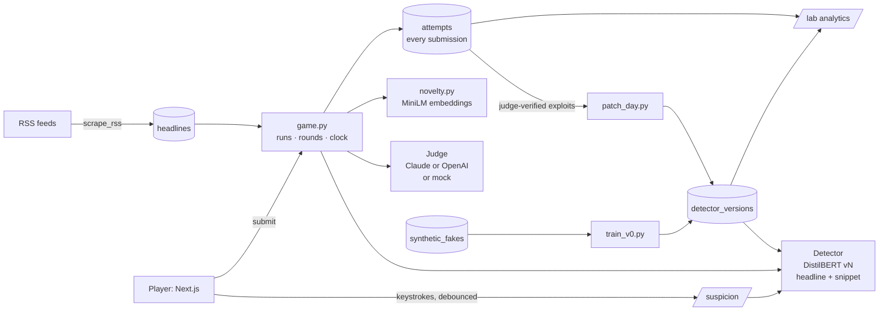

# Sneak It Past

**Edit a true headline into a lie the AI can't catch. Every trick that works trains it.**

You get a real headline from today's news and a snippet of the article behind it.
Change up to three words to make it false. A live **suspicion meter** shows what
our misinformation detector thinks as you type. Submit, and a judge model checks
that you really did make it false. Keep suspicion under 50% and you **sneak it
past**; go over and you're **caught**. Three lives, a clock, streaks, bounties.

Every trick that gets through is adversarial training data. On **patch days** the
detector retrains on them, so the game gets harder and the detector gets better
at exactly the lies people find.

---

## Quick start

```bash
npm run setup       # venv, deps, seed headlines, stub detector, frontend packages
npm run dev         # API on :8000, web app on :3000
```

Open **http://localhost:3000**. That's a complete, playable game with **no API key
and no GPU**: the stub detector and a rule-based mock judge stand in.

For the real thing:

```bash
cp .env.example .env              # then set ANTHROPIC_API_KEY *or* OPENAI_API_KEY
cd backend && .venv/bin/python -m judge.check && cd ..   # verify the key and model
npm run setup:ml                  # torch + transformers (~1 GB), training fakes, DistilBERT v0
npm run scrape                    # fresh headlines from the RSS feeds
```

The judge and v0's fake-writer use whichever key you set (Anthropic wins if both
are): **Claude** (Sonnet 5.5 judge, Opus 5.5 fakes) or **OpenAI** (`gpt-4o-mini`
judge, `gpt-4o` fakes by default — `judge.check` lists the models your key can use;
override with `SIP_OPENAI_JUDGE_MODEL` / `SIP_OPENAI_FAKES_MODEL`). Both get the
identical prompt and must answer in the identical JSON schema. Without any key,
v0 trains on rule-made fakes and the version note says so — re-run
`npm run fakes && npm run train-v0` once you have one.

**Requirements:** Node 18+, Python 3.11–3.13 (setup picks one automatically;
3.14 is too new for some pinned wheels). Apple-silicon or CUDA GPUs speed up
training but aren't needed: v0 trains in about a minute on a laptop.

**API cost:** pay-as-you-go on either provider. A judge call is a short
classification (well under 1¢ on a small model), so even thousands of submissions
cost a few dollars; generating v0's fakes is a one-off of similar size.

### Commands

| Command | What it does |
|---|---|
| `npm run setup` | Core setup: venv, requirements, seed headlines, stub detector, frontend |
| `npm run setup:ml` | ML stack, training fakes, DistilBERT v0 |
| `npm run dev` | API + web app |
| `npm run scrape` | Pull fresh headlines from the configured RSS feeds |
| `npm run fakes` | Make training fakes (Claude with a key, rules without) |
| `npm run train-v0` | Train detector v0 |
| `npm run patch-day` | Retrain on human exploits → next version (`-- --dry-run` to only evaluate) |
| `npm run bounties` | Re-flag bounty headlines against the live detector |
| `npm test` | Backend tests (42) |

**On stage:** `POST /api/admin/patch-day` with header `x-admin-token` (default
`sneak-demo`, set `SIP_ADMIN_TOKEN`) runs a patch day in the background; the
running server switches to the new version within 5 seconds, no restart.

---

## How a round works

1. **Read.** A real headline (BBC, NPR, The Guardian, Al Jazeera, PBS — configurable)
   and its article snippet. ~15% are **bounties**: headlines the detector already
   suspects, so hiding a lie in them is hard. Bounties pay 3× and get +5 s.
2. **Edit.** Up to three word changes, counted by a word-level diff (substitutions,
   insertions, deletions; case and punctuation don't count). The meter calls the
   detector 300 ms after you stop typing.
3. **Submit.** The clock pauses while the judge rules, so API latency never costs
   you time. The detector's score is recomputed server-side; the client's meter is
   never trusted.
4. **Outcome.**
   - Judge says it isn't false, isn't plausible or isn't grammatical → *not a lie*.
     No life lost, but that try is used (3 per headline; a third ends the round and
     your streak).
   - False and suspicion < 50% → **SNUCK PAST**. Suspicion 40–50% is a near miss:
     "so close!".
   - False and suspicion ≥ 50% → **CAUGHT**, −1 life.
   - Clock runs out → **TIME'S UP**, counts as caught.

### Scoring

```
points = round(1000 × (1 − suspicion))
       × words     1 word = 3×, 2 = 2×, 3 = 1×
       × streak    1 + 0.1 × streak, max 2×
       × time      1 + 0.5 × (seconds left / starting seconds)   → up to 1.5×
       × novelty   1.5× for a zero-day exploit
       × bounty    3× on bounty headlines
```

**Timer:** 20 s, −1 s per streak level (minimum 10 s), +5 s on bounties. The server
owns the clock; a submit up to 1.5 s late still counts (network slack).

**Novelty ("zero-day exploit"):** each edit is embedded with `all-MiniLM-L6-v2` as
(the shift in meaning from original to edited headline) ⊕ (the word move itself,
e.g. "rises → falls"). If its cosine distance to every earlier exploit is ≥ 0.35
(`SIP_NOVELTY_THRESHOLD`), it's a new trick: +50% and a place on the Exploit Board.
Calibration: the same trick on a different headline scores ~0.12; different
kinds of trick score ~0.9.

---

## Architecture



```
backend/
  app/
    main.py         FastAPI routes
    game.py         runs, rounds, the server-side clock, outcomes, logging
    scoring.py      points and timer rules (pure functions)
    diffing.py      word-level diff, the 3-word rule
    novelty.py      zero-day detection
    analytics.py    everything on /lab
    models.py       SQLite schema (below); db.py adds missing columns on startup
  judge/            prompt.py (shared instructions + schema), claude_judge.py, openai_judge.py,
                    mock_judge.py, check.py (verify your key/model)
  detector/
    baseline.py     phase-1 stub: logistic regression on headline-vs-snippet features
    distil.py       DistilBERT sentence-pair classifier + shared fine-tuning loop
    train_stub.py   train_v0.py   patch_day.py
    splits.py       the one train/test split by headline every version shares
    evaluate.py     catch rate, false-alarm rate, AUC — same for every version
    registry.py     loads versions, tracks which is live, rechecks every 5 s
    bounties.py
  ingest/           scrape_rss.py, seed.py, make_fakes.py (LLM fakes), perturb.py (rule fakes)
  tests/            42 tests, throwaway DB + mock judge, no model download or API calls
frontend/
  app/              / (start + research notice), /play, /board, /lab
  components/       HeadlineEditor, SuspicionMeter, TimerBar, OutcomeCard, ShareCard, …
  lib/              API client, word diff, sound kit, chart tokens
data/
  seed/headlines.json   committed sample of real headlines (offline play)
  detectors/            trained versions (gitignored; v0 is ~250 MB)
  sneak.db              the database (gitignored)
```

### Why the detector reads the snippet

The detector takes **(headline, article snippet)** as a sentence pair, not the
headline alone. A headline-only model can't know that "rates rise 0.25%" is true
and "rates rise 0.5%" is false — it can only learn the *style* of fakes, so patch
days would teach it surface patterns rather than anything that generalises. Reading
the source makes it a claim-verification model: *is this headline supported by its
article?* Still small and fast: ~20 ms per call on a laptop CPU.

### Detector versions

| Version | What it is | How it's measured |
|---|---|---|
| `stub` | Logistic regression on consistency features (unsupported numbers, names, negations) | Held-out AUC 0.67 on the shared test split |
| `v0` | DistilBERT on true headlines vs machine-made fakes | Held-out AUC 0.82, catches 76% of fakes, flags 22% of true headlines *(rule-made fakes; re-run with a key for LLM fakes)* |
| `v1, v2, …` | v(n-1) fine-tuned on judge-verified human exploits + their original headlines + v0's data | Scored on held-out human exploits, true headlines and synthetic fakes |

**Honest evaluation.** Every exploit fooled whichever version was live when it was
made, so scoring that version on its own exploits is meaningless. Instead, a stable
~20% of exploits (chosen by a hash of the attempt id) is **never trained on by any
version**, and every version is scored on that set. Next to it: the false-alarm rate
on held-out true headlines (a detector that flags everything would catch every
exploit) and the catch rate on held-out machine-made fakes (did patching make it
forget?). That is the `/lab` headline chart.

---

## Data schema

| Table | One row per | Key fields |
|---|---|---|
| `headlines` | real headline | `text`, `snippet`, `source`, `url`, `published_at`, `is_bounty`, `detector_p`, `active` |
| `players` | display name | `name`, `runs`, `best_score`, `is_bot` |
| `runs` | game (3 lives) | `lives`, `streak`, `best_streak`, `score`, `snuck`, `caught`, `detector_version` |
| `rounds` | headline in a run | `timer_start_s`, `paused_s` (judge time refunded), `attempts_used`, `status` |
| `attempts` | **every submission** | see below |
| `synthetic_fakes` | machine-made fake | `headline_id`, `text`, `edit_type`, `generator` (claude/rules), `model` |
| `detector_versions` | trained detector | `name`, `kind`, `path`, `is_current`, `n_train`, `metrics_json`, `note` |

`attempts` — the research log. Every submission is logged, valid or not:

| Field | |
|---|---|
| `round_id`, `run_id`, `player_id` (anonymous), `created_at`, `attempt_no` | identity and time |
| `headline_id`, `original_headline`, `edited_headline` | the edit |
| `changed_words_json`, `num_words_changed` | the word-level diff |
| `suspicion_score_final`, `suspicion_trace_json` | final score and every meter reading while typing, with ms timestamps and the text at that moment |
| `judge_output_json`, `edit_type` | the judge's full verdict, incl. which judge (`claude` / `openai` / `mock`) and model |
| `outcome` | `snuck` / `caught` / `invalid` / `timeout` |
| `points`, `streak`, `lives_left` | game state after this attempt |
| `detector_version`, `is_bounty` | what it was played against |
| `novelty_distance`, `is_novel`, `edit_embedding_json` | zero-day detection |
| `time_to_submit_ms`, `timer_start_seconds`, `time_remaining_at_submit`, `timed_out` | the clock |
| `patched_in`, `patch_notified` | which later version caught it, and whether the player has been told |

---

## Ethics and handling

This game asks people to write misinformation, so the handling is part of the design:

- **Everything players write is synthetic misinformation, and stays in our
  database.** It is stored labelled with how it was made, and there is no public
  feed, export endpoint or API that returns it outside the game.
- **Player-made fakes are only ever displayed with a "FAKE — made in Sneak It
  Past" label**, and only as the struck-through original plus the changed words
  (Exploit Board, analytics) — never as a clean, quotable headline.
- **Share cards carry scores only.** No headline text, original or edited, ever
  goes into a share string.
- **Players are told up front** (before their first run) that their edits are logged
  for research and model training, are synthetic misinformation, and shouldn't be
  copied elsewhere.
- **The machine-made fakes used to train v0** are stored the same way: labelled
  with their generator, never shown to players.
- **Mock-judged data is kept apart.** Without an API key a rule-based mock judges
  submissions; every such verdict is tagged, patch days ignore it by default, and
  `/lab` can filter it out. It is development data, not research data.
- **Anonymous by default.** A display name in `localStorage` and a row in
  `players`; no email, no account, no tracking.
- **Source material** is real headlines and short RSS snippets, kept with their
  source URL and date, used for research. We assume reputable outlets' headlines are
  true as published; a headline later corrected should be deactivated
  (`headlines.active = 0`).

---

## Known limitations

- **No API key yet → mock judge and rule-made fakes.** The game, logging, patch
  days and dashboard all work, but the judge's verdicts and v0's training data are
  stand-ins until a key is set. Neither LLM judge has been exercised against its live
  API yet (unit tests stub the calls) — run `python -m judge.check` first.
- **The spec asked for the Anthropic API.** OpenAI is supported as a drop-in
  alternative for the judge and fakes; verdicts record which provider and model
  ruled, so results from the two shouldn't be mixed without saying so.
- **Small data.** ~115 seed headlines; v0 trains on ~250 pairs. Scrape regularly
  before an event. A patch day needs ≥ 5 judge-verified exploits, and the headline
  chart needs held-out exploits (≈ 1 in 5) before it shows anything.
- **Selection effects.** Exploits are, by construction, the edits the live detector
  missed. The held-out set measures generalisation fairly, but it is drawn from what
  players happened to try, not a random sample of all possible lies.
- **Truth is relative to the snippet.** The judge rules on whether an edit is false
  *relative to the original headline and its snippet*, not against the world.
- **The clock runs on the server; the bar is a client animation.** A backgrounded
  tab may show a stale bar; the server's verdict is what counts.
- **SQLite** is fine for a room full of phones, not for production scale. `SIP_DB_URL`
  accepts any SQLAlchemy URL (e.g. Postgres) — untested beyond SQLite.
- **DistilBERT versions are ~250 MB each** on disk; `/lab` loads each one briefly to
  score it, then frees it.
