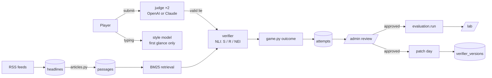

# Sneak It Past

**Players write false headlines that a search-backed fact-checker wrongly marks as SUPPORTED. Every win is a real fact-checker failure.**

## Project focus

We are **not** building a general "detect all misinformation" model. A text-only
detector can't check facts, and a subtle edit doesn't change a headline's style, so
style alone isn't enough.

Our detector is a **search-backed fact-checker**: it retrieves evidence from our
corpus of scraped news articles and asks a verification model whether that evidence
supports the claim. Search finds the evidence, but fact-checking models often
*misread* it — numbers, swapped roles (who did what to whom), cause vs. correlation,
time shifts, negation, quantifiers. Players hunt for exactly those misreadings.

The game produces:

1. **A dataset of human-found fact-checker failure modes** — every edit, the evidence
   the verifier read, and how it ruled.
2. **A verifier that improves on them** through retraining ("patch days").
3. **A controlled comparison:** do human-found failures teach the model more than
   LLM-generated ones? Same base model, same settings, same training-set size.

---

## How a round works

You get a real headline and a snippet of its article. Change **up to three words**
to make it false. A **first-glance meter** reacts as you type: the fact-checker's read of
your edit against the single best passage of the source article (~0.1 s). It's only a
preview — on submit the fact-checker searches more evidence and makes the real call
(`SIP_METER=style` switches the meter to the small style model instead). On submit:

1. **The judge rules — twice.** An LLM judge reads the original, the snippet and
   your edit with two differently worded prompts. Both must agree it's false, or it
   doesn't count — a split costs no try (it's the judges' uncertainty, not yours), and
   the identical edit can't be resubmitted to re-roll them. (For plausibility and grammar a split vote is borderline, so an edit
   only fails those if both runs flag it.) It also scores:
   - **materiality** 1–5 — would a reader believe something false *and meaningful*?
     Below 3 is **"Too pedantic"**: invalid, no points, no life lost.
   - An invalid edit costs nothing but time: **tries are unlimited while the clock
     runs** (one submission per second; `SIP_MAX_ATTEMPTS` sets a cap if you want one).
   - **specificity** 1–5 of the original and the edit, plus **vagueness flags**
     (added "may", "reportedly", "many", unnamed sources…). Dropping specificity by 2+
     or any flag is **"Too vague"**: points ×0.5, or **caught** if specificity ≤ 2.
     Keeping specificity ≥ 4 is a **"Sharp lie"**: ×1.5.
2. **The evidence verifier decides.** It retrieves the top 3 passages (BM25) from
   the article corpus and rates each SUPPORTED / REFUTED / NOT ENOUGH INFO.
   - **SUPPORTED → SNUCK PAST** — full points, streak +1, *"Misread evidence!"*
   - **NOT ENOUGH INFO → PARTIAL** — ×0.3, streak held but doesn't grow
   - **REFUTED → CAUGHT** — lose a life, streak resets
3. **The reveal** shows the verdict, its probabilities and the passages it read, so
   you learn *why* you were caught.

**Two modes.** *Evidence mode* (default): your headline's own article is in the
index, so a win means the verifier misread evidence it had. *Breaking-news mode*
(bounty rounds): the source article is excluded, simulating a story nobody has
covered yet. Every log row records the mode.

Three lives, a 40-second clock (−2 s per streak level, never below 20 s; paused while
the judge and verifier work), bounties (3×, +10 s), and "zero-day exploit" novelty bonuses.
**Enter submits.** If the clock runs out, whatever is in the box is **auto-submitted**
and judged as usual, provided it's a legal edit (1–3 word changes); an illegal edit,
or an auto-submitted one the judge rules not a lie, is **time's up** (counts as caught).

### Scoring

```
points = round(1000 × (1 − verifier P(refuted)))
       × words        1 word = 3×, 2 = 2×, 3 = 1×
       × streak       1 + 0.1 × streak, max 2×
       × time         1 + 0.5 × (seconds left / starting seconds)
       × novelty      1.5× zero-day exploit (new kind of trick, by embedding distance)
       × bounty       3×
       × materiality  3 → 1×, 4 → 1.25×, 5 → 1.5×
       × sharp lie    1.5×        × too vague   0.5×        × partial   0.3×
```

---

## Quick start

```bash
npm run setup        # venv, deps, seed headlines, stub style model, frontend
npm run setup:ml     # torch + transformers (~1 GB) for the verifier and style model
npm run articles     # fetch article bodies → the evidence corpus
npm run dev          # API on :8000, web app on :3000
```

Open **http://localhost:3000**. Set **one** API key in `.env` (copy `.env.example`):
`OPENAI_API_KEY` (judge `gpt-4.1-mini`, fakes `gpt-4.1`) or `ANTHROPIC_API_KEY`
(Claude Sonnet 5.5 / Opus 5.5); Anthropic wins if both are set. Check it with
`cd backend && .venv/bin/python -m judge.check`. Without a key a rule-based **mock
judge** stands in; its verdicts are tagged and excluded from research data.

**Requirements:** Node 18+, Python 3.11–3.13 (setup picks one; 3.14 is too new for
some wheels). A GPU (Apple-silicon MPS or CUDA) speeds up training; inference runs
on CPU (~0.25 s per verification, on submit only).

| Command | What it does |
|---|---|
| `npm run refresh` | New headlines end to end: scrape RSS → fetch article bodies → LLM-screen for a checkable fact → re-flag bounties |
| `npm run scrape` / `articles` / `screen` | The same steps one at a time |
| `npm run dev` | API + web app |
| `npm run evaluate` | The controlled comparison (below); `-- --dev` includes unreviewed exploits, for testing only |
| `npm run patch-day` | Retrain the verifier on approved exploits → `v<n>-human`, gated (`-- --dry-run`) |
| `npm run patch-style` | Retrain the first-glance style model on exploits |
| `npm test` | Backend tests (no model downloads or API calls) |

Pages: `/` start, `/play`, `/board` (exploit board + best runs), `/learn` (how the AI
learns, step by step, with live numbers), `/lab` (analytics), `/admin` (review; token
`SIP_ADMIN_TOKEN`, default `sneak-demo`).

---

## Data collection and review

Data volume is the biggest risk. **Start playing as soon as it runs** — the team and
friends, no waiting for polish.

- Every attempt is logged (fields below), including the full suspicion trace.
- Exploits (snuck or partial) start as **pending**. Reviewers on `/admin` approve or
  reject each one with the original, the edit, both judge runs and the evidence in
  front of them. **Only approved exploits train or evaluate a verifier.** Every
  decision is kept, so `/admin` and `/lab` report the judge's precision against
  human review.
- **Target: ≥ 150 approved exploits before the first patch day**, around the
  hackathon's midpoint; keep collecting after it — those become the *fresh* test set.
- `/admin` counts attempts, judge-valid lies, exploits, approved / rejected / pending,
  by edit type, with progress toward 150.

---

## Evaluation

`npm run evaluate` runs the whole plan and writes `data/eval/results/<time>.json`
(and `latest.json`, which `/lab` reads).

**Splits.** Approved exploits are split **by headline** ~70/30 (seed 13, saved to
`data/eval/split.json`, only ever extended), so no headline is on both sides. The
test side's headlines, unedited, are the held-out **true** set (false positives).
Exploits made after the latest patch day are the **fresh** set.

**Models** — same base (`MoritzLaurer/DeBERTa-v3-base-mnli-fever-anli`), same
settings (3 epochs, lr 1e-5, batch 8, seed 7), same number of training examples:

| Model | Trained on |
|---|---|
| `v0` | nothing — the off-the-shelf verifier |
| `v1-synthetic` (control) | LLM-written edits of the **same training headlines**, matched to the human set's edit-type counts, passed through the **same judge filters** |
| `v1-human` | approved human exploits (REFUTED) + their matched true headlines (SUPPORTED), on the same source evidence |
| `v1-combined` | half human + half synthetic |

**Test sets:** held-out human exploits (the main test), held-out true headlines,
fresh exploits, and a seeded sample of **VitaminC** (public contrastive
fact-verification data) to check improvements generalise.

**Metrics,** each with a **95% bootstrap interval (1,000 resamples)**: refute recall
on exploits, false-positive rate on true headlines, VitaminC accuracy and macro-F1,
and all of it **by edit type**.

**The claims we test:** which edit types the verifier misses most even with evidence
retrieved; v1-human vs. v0; **v1-human vs. v1-synthetic** (does human-found data teach
something LLM data doesn't?); and sanity — no big jump in false positives, no drop on
VitaminC. We report the numbers we get, including small or negative ones.

---

## Architecture



```
backend/
  app/          main.py (routes) · game.py (rounds, clock, outcomes) · scoring.py
                review.py · analytics.py · novelty.py · diffing.py · models.py
  judge/        prompt.py (rubric, two phrasings, schema) · base.py (two-run ruling)
                openai_judge.py · claude_judge.py · mock_judge.py · check.py
  verifier/     retrieval.py (BM25) · model.py (3-way NLI + aggregation) · verify.py
                registry.py · train.py (shared fine-tuning) · patch_day.py
  detector/     the first-glance style model (stub / transformer), its training and bounties
  evaluation/   data.py (splits, matched pairs, synthetic control, VitaminC)
                metrics.py (bootstrap CIs) · run.py
  ingest/       scrape_rss.py · articles.py · seed.py · make_fakes.py · perturb.py
frontend/app/   / · /play · /board · /lab · /admin
```

## Data schema

| Table | One row per |
|---|---|
| `headlines` | real headline: text, snippet, source, url, published_at, bounty |
| `passages` | evidence chunk: snippet (idx 0) or ~70 words of article body |
| `players`, `runs`, `rounds` | player · game (lives, streak, score, snuck/partial/caught) · headline in a run (clock, mode) |
| `attempts` | **every submission** — see below |
| `reviews` | one reviewer decision on one exploit |
| `verifier_versions` | v0, v1-human, v1-synthetic, v1-combined, patch versions — path, training data, metrics |
| `detector_versions` | first-glance style model versions |
| `synthetic_fakes` | machine-made edits (v0 style-model data, and the evaluation's synthetic control) |

`attempts` fields: identity (`round_id`, `run_id`, anonymous `player_id`, time,
`attempt_no`) · the edit (`original_headline`, `edited_headline`, `changed_words`,
`num_words_changed`) · `mode` · the verifier (`verifier_version`, `verifier_verdict`,
`verifier_probs`, `retrieved_passage_ids`) · the judge (`judge_output_json` holds
both runs and the combined ruling; `materiality`, `specificity`,
`original_specificity`, `vagueness_flags`, `edit_type`, `tags`) · the first-glance
`suspicion_score_final` and `suspicion_trace` · `outcome`, `points`, `streak`,
`lives_left` · `novelty_distance`, `is_novel` · the clock (`timer_start_seconds`,
`time_remaining_at_submit`, `timed_out`, `time_to_submit_ms`) · review
(`review_status`, `reviewer_id`, `reviewed_at`) · `split` · `patched_in`.

---

## Ethics and handling

- **Player-made headlines are synthetic misinformation.** They stay in our database,
  labelled, with no public feed or export. Wherever they're shown (Exploit Board,
  `/lab`, `/admin`) they carry a **"FAKE — made in Sneak It Past"** label; outside
  `/admin` only as the struck-through original plus the changed words.
- **Players are told before their first run** that edits are logged for research
  and model training.
- **Share cards carry scores only**, never headline text.
- **Article text** is fetched once per story (identifying user agent, 1 s between
  requests), stored for research only, and shown to players only as the short
  passages the verifier used, attributed and linked to the source.
- **Machine-made edits** (the synthetic control, v0 style data) are stored the same
  way and never shown to players.
- **Mock-judged data is kept apart** and excluded from training and evaluation.
- **Anonymous:** a display name only; no email, no account, no tracking.

## Known limitations

- **Small corpus.** ~115 headlines / ~950 passages. Breaking-news rounds often find
  no other coverage (→ NOT ENOUGH INFO); scrape regularly to grow it.
- **Evidence is ours, not the web's.** Retrieval covers only articles we scraped.
- **The judge rules relative to the original headline and snippet**, not the world.
  Human review exists because the judge can be wrong; its precision is reported.
- **Selection effects.** Exploits are, by construction, edits the live verifier
  missed; held-out results describe what players tried, not all possible lies.
- **Sample sizes are small** — hence the bootstrap intervals; overlapping intervals
  mean no detectable difference.
- **The spec asked for the Anthropic API** for the judge and synthetic control; OpenAI
  is supported as a drop-in and results record which provider ran.
- **SQLite** — fine for a room of phones, not for production.
